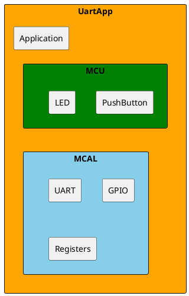
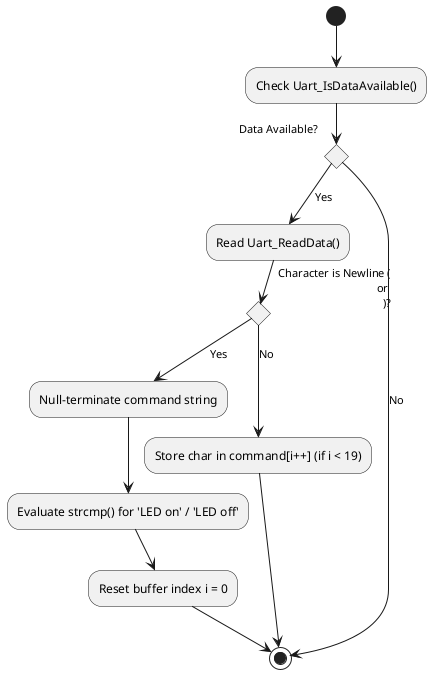
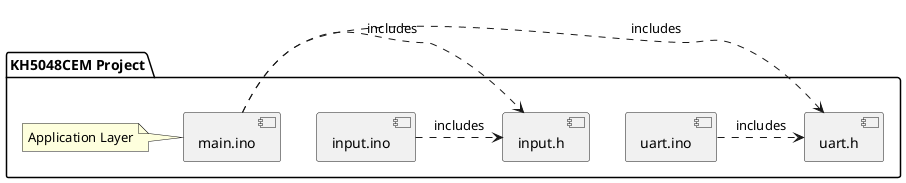

# Design Document

| **Author**              | `Fares Aboelsoud`                                       |
|:------------------------|:-----------------------------------------------------|
| **Status**              | `Approved`                          |
| **Version**             | `1.0`                                                |
| **Date**                | `22/10/2026`                                         |

## Introduction

#### This document provides the design of The system that is built around the AVR ATmega328P 8-bit microcontroller, running natively in C via direct register manipulation without pre-developed Arduino libraries or hardware abstraction frameworks.

### Purpose
#### The purpose of this software module is to establish robust bidirectional serial communication over UART to:
* Acquire digital push-button input states (PD2) and transmit state-change notifications ("button is pushed" / "button is released") to a host PC.
  
* Receive asynchronous command strings ("LED on" / "LED off") from the host PC over UART to control a digital output LED (PD4).

### Scope
#### The scope focuses on the system's architectural layers, hardware-software integration, low-level register configuration (DDRD, PORTD, PIND, UDR0, UCSR0A/B/C, UBRR0), input debouncing, and robust string command parsing.

## Architectural Overview

### This system is structured into a modular 3-layer architecture separating application logic, peripheral drivers, and microcontroller registers.

### Assumptions & Constraints
* Clock Frequency: Fixed at $F_{\text{CPU}} = 16\text{ MHz}$ (standard Arduino Uno / ATmega328P crystal oscillator). 
* Baud Rate Accuracy: Configured for $9600\text{ bps}$ asynchronous normal mode ($\text{U2X0} = 0$), yielding a baud register error rate well within tolerance limits.
* Memory Constraints: Designed to operate efficiently within the limited SRAM of the ATmega328P using static buffers (char command[20]) and lightweight 8-bit loop counters (unsigned char).

## Functional Description
### The software executes a continuous polling loop within main():
* Digital Input Polling: Periodically reads pin PD2 via Button_Read(). State changes are filtered through a $50\text{ ms}$ software debounce delay before transmitting ASCII strings via Uart_SendString()
  
* UART Character Reception: Non-blocking polling via Uart_IsDataAvailable() retrieves incoming bytes one at a time via Uart_ReadData(). Characters accumulate until a carriage return or newline triggers string comparison via strcmp().

## Implementation of the Module
The project is seperated into 5 modular source and header files adhering strictly to top-down design principles:

## Integration and Configuration
### Static Files

| File name | Contents                             |
|-----------|--------------------------------------|
| main.ino | Application layer containing main() logic, polling loop, and command evaluation         |
| uart.h     | Exported interface prototypes for initialization, baud configuration, and I/O    |
| uart.ino    | Low-level register implementation of the UART driver |
| input.h | Exported interface prototypes for button reading and LED actuation |
| input.ino | Low-level register implementation of digital I/O |

### Include Structure

### Configuration

| Name | Value range | Description |
|------|-------------|-------------|
| F_CPU | 16000000UL | Microcontroller system clock frequency 16MHz |
|BaudRate | 9600 | Asynchronous serial communication speed in bits per second |
| RX_BUFFER_SIZE | 20 | Maximum character length for incoming UART command strings |
